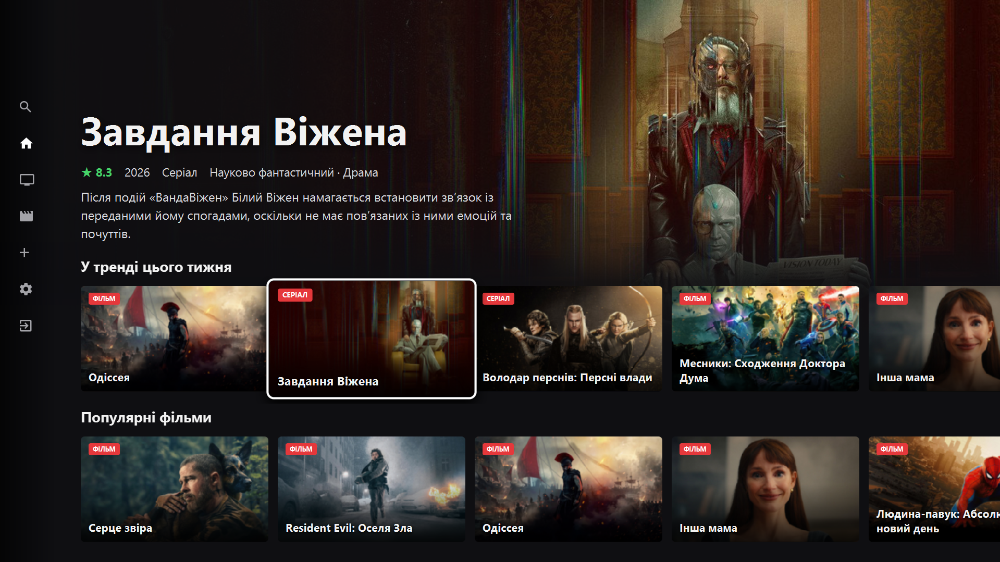
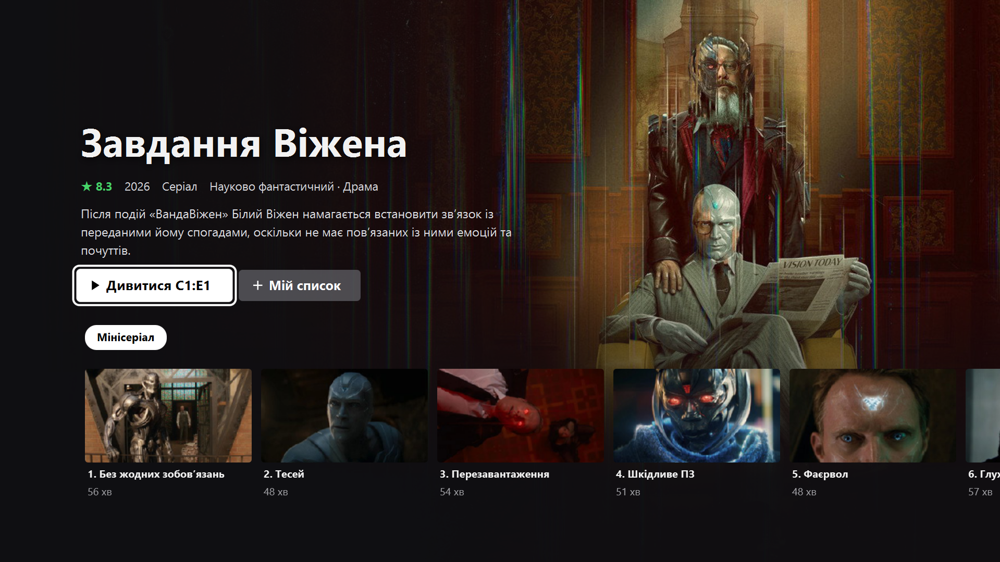

# KinoBox

Desktop-застосунок для Windows 11 для перегляду фільмів і серіалів з інтерфейсом у стилі TV-сервісів.
Повністю керується з геймпада **DualSense** (або з клавіатури), без миші.

**Стек:** Java 25 (LTS) + JavaFX 25, vlcj (libVLC) для відео, TMDB API для каталогу. Окремого бекенду немає.



## Можливості

- **Головний екран як у TV-сервісах:** великий банер з описом тайтла у фокусі, горизонтальні ряди карток,
  бокове меню з розділами «Головна», «Серіали», «Фільми», «Мій список», «Пошук», «Налаштування».
- **Каталог з TMDB українською:** тренди, популярне, найвищий рейтинг, українське кіно, ряди за жанрами;
  справжні кадри й постери з кешем на диску.
- **Сторінка тайтла:** опис, рейтинг, жанри, «Мій список»; для серіалів — сезони й епізоди з кадрами.
- **Пошук** з повноекранною екранною клавіатурою (ЙЦУКЕН / QWERTY), зручною для геймпада.
- **Плеєр на vlcj:** відтворює все, що вміє VLC (MKV, HEVC, кілька аудіодоріжок, субтитри);
  компактний режим із серіями збоку, меню аудіодоріжок і субтитрів.
- **«Продовжити перегляд»:** позиція зберігається автоматично, ряд на головній, смужка прогресу на картках.
- **DualSense напряму через SDL** (USB і Bluetooth): автоповтор при утриманні, гаряче підключення, вібрація.
- Працює й **без інтернету / без ключа TMDB** — на демо-даних.

## Вимоги

| Що                      | Навіщо                                                                                                |
|-------------------------|-------------------------------------------------------------------------------------------------------|
| **JDK 25**              | Temurin, Oracle тощо. Gradle завантажиться сам через wrapper                                           |
| **VLC 3.x, 64-bit**     | vlcj керує бібліотекою libVLC, яка ставиться разом із VLC. 32-бітна версія не підійде                  |
| **Токен TMDB** (опційно)| Безкоштовний *API Read Access Token* з themoviedb.org → Settings → API. Без нього — демо-дані          |

### Токен TMDB

Токен **не зберігається в репозиторії**. Створіть файл `%USERPROFILE%\.kinobox\tmdb.properties`
(наприклад, `C:\Users\<ім'я>\.kinobox\tmdb.properties`) з одним рядком:

```properties
token=eyJ...ваш_API_Read_Access_Token...
```

### Логотип TMDB

Умови TMDB вимагають логотип в розділі «Про програму». Завантажте офіційний PNG зі сторінки
*Logos & Attribution* на сайті TMDB і покладіть його як `src/main/resources/ua/kinobox/tmdb-logo.png`.
Без файлу застосунок працює, але показує лише текстову атрибуцію.

## Запуск

**IntelliJ IDEA:** `File → Open` → тека `kinobox` → дочекатися імпорту Gradle → у вікні Gradle запустити
`Tasks → application → run`. В `Settings → Build Tools → Gradle` має бути *Gradle JVM* = JDK 25.
Можна запускати й зеленою стрілкою біля `main()` у `Launcher`: `build.gradle.kts` налаштовує будь-яку
задачу запуску однаково, тож попереджень JavaFX не буде.

З терміналу:

```bash
./gradlew run          # Windows: gradlew.bat run
./gradlew test         # тести
```

### Аргументи

| Аргумент                  | Що робить                                                       |
|---------------------------|-----------------------------------------------------------------|
| `--windowed`              | Запуск у вікні замість повного екрана (зручно для розробки)     |
| `--video=шлях_або_URL`    | Яке відео відкривати в плеєрі (поки одне для всіх тайтлів)      |

```bash
./gradlew run --args="--windowed --video=C:\Videos\test.mkv"
```

В IntelliJ — поле *Program arguments* у конфігурації запуску.

## Керування

### Навігація

| Дія                          | DualSense                                   | Клавіатура                |
|------------------------------|---------------------------------------------|---------------------------|
| Навігація                    | D-pad / лівий стік (утримання = автоповтор) | Стрілки / WASD            |
| Вибрати                      | ✕                                           | Enter / Space             |
| Назад; відкрити/закрити меню | ○                                           | Esc / Backspace           |
| Гортати ряд на 5 карток      | L1 / R1, L2 / R2                            | PgUp / PgDn, Q / E        |
| Вийти                        | меню → «Вийти»                              | меню → «Вийти» або Alt+F4 |

Коли далі рухатися нікуди, DualSense коротко вібрує.

### Плеєр

| Дія                                   | DualSense        | Клавіатура        |
|---------------------------------------|------------------|-------------------|
| Пауза / продовжити                    | ✕                | Enter / Space     |
| −10 / +10 секунд                      | ← / →            | ← / →             |
| −30 / +30 секунд                      | L1, L2 / R1, R2  | PgUp / PgDn       |
| Компактний режим (серії, «Почати спочатку») | □          | F / F11           |
| Аудіодоріжки й субтитри               | Options          | M                 |
| Закрити плеєр                         | ○                | Esc               |

### Пошук

| Дія                                   | DualSense             |
|---------------------------------------|-----------------------|
| Стерти символ                         | □                     |
| Пробіл                                | △                     |
| Очистити                              | L1 / L2               |
| Шукати й перейти до результатів       | R1 / R2 / Options     |
| З результатів назад на клавіатуру     | ○                     |

З фізичної клавіатури: стрілкою вгору перейдіть у поле пошуку й друкуйте як зазвичай.

### DualSense на Windows

DualSense читається напряму через SDL, XInput-емулятори не потрібні. Якщо геймпад не з'являється,
закрийте **DS4Windows** (він ховає пристрій) і перевірте, що **Steam** не перехоплює його
(*Steam → Налаштування → Контролер → PlayStation*).

## Де зберігаються дані

Усе — у `%USERPROFILE%\.kinobox\`, поза текою проєкту:

| Файл / тека              | Вміст                                              |
|--------------------------|----------------------------------------------------|
| `tmdb.properties`        | токен TMDB (створюєте самі)                        |
| `progress.properties`    | позиції перегляду відео                            |
| `history.json`           | історія переглядів для «Продовжити перегляд»       |
| `mylist.json`            | «Мій список»                                       |
| `cache/images/`          | кеш постерів і кадрів (можна очистити в «Налаштуваннях») |

## Архітектура

```
ua.kinobox
├── app/    KinoBoxApp — збирає все разом; Launcher — точка входу
├── input/  Command (UP, ACCEPT, BACK…), KeyboardInput, GamepadInput (Jamepad/SDL), InputRouter
├── nav/    SpatialNavigator — фокус «стрілками» за геометрією; ScrollUtil — плавна прокрутка до фокуса
├── ui/     ScreenManager (стек екранів)
│           HomeScreen, DetailsScreen, EpisodesSection, SearchScreen, SettingsScreen, PlayerScreen
│           Billboard, PosterCard, Artwork, ImageCache, Toast, FocusZoom, Icons
└── data/   Title, Season, Episode, CatalogRow
            CatalogService ← TmdbCatalogService (TmdbClient) / MockCatalogService
            ProgressStore, WatchHistory, MyList
```

Ключові ідеї:

- **Усі пристрої перетворюються на `Command`.** Екрани працюють лише з командами і фокусом, тож новий пристрій
  (пульт, інший геймпад) додається одним класом в `input/`, а нові екрани одразу працюють з геймпадом.
- **`SpatialNavigator` не прив'язаний до контейнерів:** будь-який `focusTraversable` елемент досяжний стрілками.
  Екран може обмежити переходи через `navigationFilter` або перехопити команду в `handle()`.
- **`CatalogService` асинхронний** (`CompletableFuture`): UI-потік ніколи не чекає на мережу.
  Джерело даних (TMDB, демо, у майбутньому Jellyfin) підставляється без змін в інтерфейсі.
- **Реактивність JavaFX:** прогрес перегляду, «Продовжити перегляд» і кнопка «Продовжити з …»
  оновлюються самі через `ObservableMap` / `ObservableList` і прив'язки.

## Дорожня карта

- [x] **1. UI-скелет:** головний екран, ряди, бокове меню, сторінка деталей, просторова навігація
- [x] **2. DualSense:** кнопки, стіки з автоповтором, гаряче підключення, вібрація
- [x] **3. TMDB:** каталог, зображення з кешем, сезони й епізоди, пошук з екранною клавіатурою
- [x] **4. Плеєр на vlcj:** оверлей керування, перемотка, компактний режим, аудіодоріжки й субтитри, продовження з місця зупинки
- [ ] **5. Jellyfin:** потоки з власної медіатеки — своє відео для кожного фільму й серії
- [ ] **6. Збереження стану:** ~~«Мій список»~~, ~~історія переглядів~~, ~~налаштування~~, профілі
- [ ] **7. Інсталятор** через `jpackage` (MSI/EXE)

## Правові примітки

- KinoBox **не містить і не завантажує фільмів**. Каталог — це лише інформація з TMDB; відтворюється відео,
  до якого у вас є законний доступ (власні файли, у майбутньому — ваш сервер Jellyfin).
- This product uses the TMDB API but is not endorsed or certified by TMDB.
- Відтворення відео — через [vlcj](https://github.com/caprica/vlcj) (GPL v3) і VLC.

## Ліцензія

[GNU GPL v3.0](LICENSE) або новіша.


